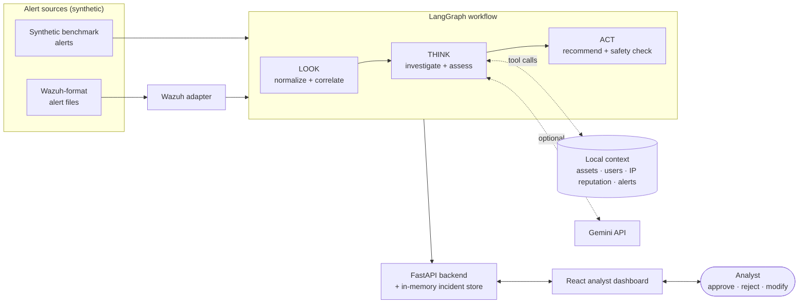
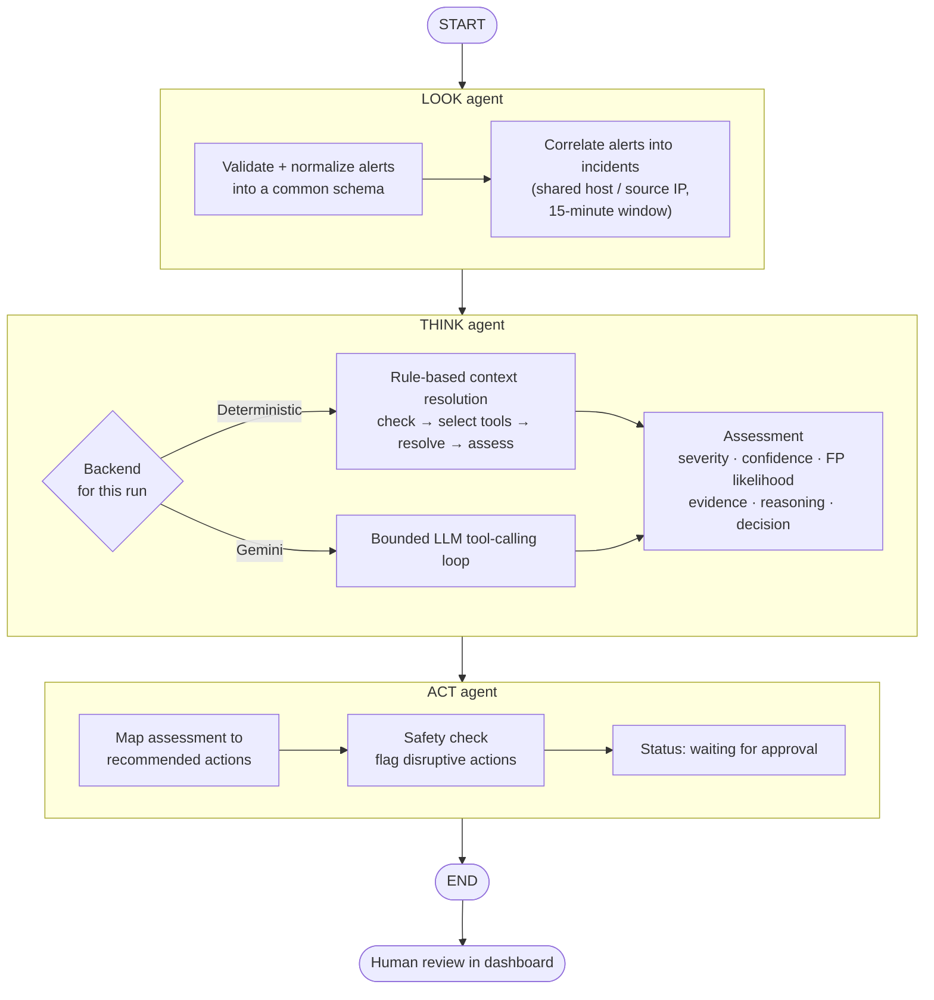
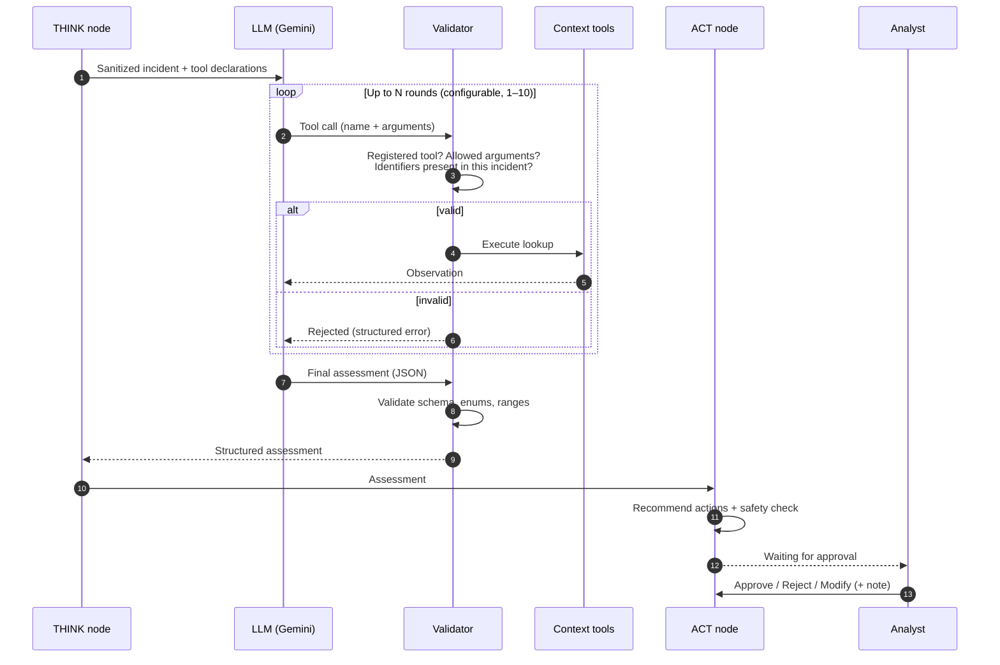

# Agentic SOC

**A human-in-the-loop, explainable security-alert triage system built on a LangGraph LOOK → THINK → ACT workflow.**

Agentic SOC takes raw security alerts, groups related activity into incidents, investigates each incident with context-lookup tools (using either deterministic rules or an LLM agent), and produces a safety-checked response recommendation that an analyst must approve, reject, or modify. The system never executes remediation on its own.

> **Status:** university prototype. All alerts and organizational context are synthetic. The project does not connect to live infrastructure, and this repository is a technical overview. It does not release the source code.


---

## Overview

Security operations teams face more alerts than they can investigate, and many alerts are only meaningful in context: who the user is, how critical the asset is, whether the source IP is known. Fully automated response is risky, while purely manual triage is slow.

Agentic SOC explores a middle path:

- **Agentic investigation.** An LLM agent decides which context to gather, calls constrained tools, and explains its assessment.
- **Deterministic guardrails.** Tool arguments, final outputs, and response recommendations are validated and constrained by code rather than left to the model.
- **Human control.** Every recommendation is routed to an analyst, with a full audit trail of what the system saw, did, and proposed.

What the project contains:

- A LangGraph pipeline with three agent stages: **LOOK**, **THINK**, and **ACT**.
- Two interchangeable THINK backends, **deterministic rules** and a **Gemini LLM agent**, selectable per run, with automatic fallback.
- Four registered investigation tools for asset, user, IP-reputation, and related-alert context.
- A FastAPI backend and a React/TypeScript analyst dashboard with approve, reject, and modify controls.
- An adapter that ingests Wazuh-format alerts (file- and fixture-based).
- A synthetic benchmark, a separate held-out evaluation set, evaluation harnesses, and automated tests.

---

## Architecture



| Layer | Responsibility |
|---|---|
| **Ingestion** | Synthetic alerts load directly. Wazuh-format records pass through an adapter that maps fields such as rule, agent, and source/destination IP into a common alert schema. |
| **Workflow** | A compiled LangGraph `StateGraph` runs LOOK → THINK → ACT over a shared typed state. |
| **Context** | Local JSON stores of assets, users, IP reputation, and alerts, reachable only through registered tools. |
| **API** | FastAPI endpoints to list scenarios, run a scenario, browse incidents, and record analyst decisions. |
| **Dashboard** | An incident queue, an investigation view (evidence, tool calls, workflow trace, timeline), and a response and approval panel. |

---

## The LOOK → THINK → ACT workflow



| Stage | Does | Does not |
|---|---|---|
| **LOOK** | Normalizes raw alerts and groups related alerts into a correlated incident. | Assess severity or call context tools. |
| **THINK** | Gathers context through tools and produces a structured assessment: severity, confidence, false-positive likelihood, evidence, reasoning, and a triage decision (escalate, continue investigating, or dismiss). | Recommend remediation or approve actions. |
| **ACT** | Turns the assessment into recommended analyst actions, runs a safety check, and routes the incident to human review. | Execute any action. |

---

## LangGraph orchestration

The top-level workflow is a compiled LangGraph `StateGraph` with a fixed order: `START → look_agent → think_agent → act_agent → END`. Each node reads and writes a shared typed state:

```text
AgentState
  raw_alerts            # sanitized: evaluation-only fields removed
  look_results          # normalized alerts + correlated incidents
  think_assessments     # assessment + execution metadata per incident
  act_recommendations   # recommendation + safety result per incident
  analyst_decision      # pending until a human acts
  status                # e.g. waiting_for_approval
  audit_trail           # append-only stage events
```

Design choices:

- **Fixed macro order, flexible THINK.** The three stages always run in sequence. The adaptive behaviour lives inside THINK, in a separate bounded sub-graph for the deterministic backend or a bounded tool loop for the LLM backend.
- **ACT stays deterministic for both backends.** Changing the reasoning engine does not change how recommendations are generated or gated.
- **Audit by construction.** Every stage appends start and completion events, tool calls, and decisions to `audit_trail`, and the dashboard renders that trail directly.
- **Execution metadata.** Each assessment records the *requested* backend, the backend and model that *actually* ran, and whether a fallback occurred.

---

## THINK: agentic tool calling



**Registered tools**

| Tool | Returns |
|---|---|
| `lookup_asset_context` | Criticality, environment, exposure, and data sensitivity of a host |
| `lookup_user_context` | Role, privilege level, MFA status, and usual login pattern |
| `lookup_ip_reputation` | Reputation, category, and whether the IP is corporate |
| `find_related_alerts` | Other alerts sharing a host or IP within a time window |

**Constraints enforced in code, not by the prompt:**

- Only registered tools can run, and unexpected arguments are rejected.
- Tool scope is limited to the incident. A lookup is allowed only for hosts, users, IPs, alert IDs, and timestamps that actually appear in the incident under investigation, so the model cannot browse arbitrary context.
- The number of tool rounds is capped.
- The final assessment must be valid structured output with enumerated severity and false-positive values and bounded score and confidence. Anything else is treated as an error and never passed on as a result.
- Evaluation-only fields, such as scenario labels and ground truth, are removed from the payload before the model sees it.

Illustrative tool exchange (pseudocode, generic identifiers):

```text
model  → lookup_user_context(username="admin-user")
system → { found: true, privilege_level: "high", mfa_enabled: true, ... }
model  → lookup_ip_reputation(ip="192.0.2.10", ip_role="source")
system → { found: true, reputation: "malicious", is_corporate: false, ... }
model  → lookup_user_context(username="user-999")      # not in this incident
system → rejected: "User lookup is limited to identifiers in the incident."
model  → final_assessment { severity: "high", confidence: 0.9, decision: "escalate", ... }
```

**Backend selection and fallback.** The analyst chooses the Deterministic or Gemini backend for each scenario run. If the primary Gemini model hits a *transient* failure (timeouts, rate limits, 5xx errors), the system retries with a fallback Gemini model. If that also fails transiently, it falls back to the deterministic backend. Configuration, authentication, and invalid-request errors are raised rather than hidden behind a fallback. The dashboard shows both the requested and the effective backend, and the server logs one concise line per assessment without keys, prompts, or model output.

---

## Human-in-the-loop and safety design

- **No autonomous execution.** ACT produces recommendations only. Nothing is blocked, isolated, or changed on any system.
- **Approval required.** Every incident ends in `waiting_for_approval`. The analyst can **approve**, **reject**, or **modify** the selected actions and attach a note, and each decision is written to the audit trail.
- **Disruptive-action flagging.** Recommendations containing disruptive operations (for example block, isolate, reset, disable, quarantine) are flagged and carry an explicit review note. Each action shows a risk level and whether approval is required.
- **Separation of reasoning and action.** THINK is instructed not to recommend remediation, and ACT derives recommendations deterministically from the validated assessment, so the LLM never directly chooses what is proposed for execution.
- **Transparent reasoning.** The dashboard exposes evidence, every tool call with its arguments and result summary, the stage-by-stage workflow trace, and a detailed timeline.
- **Data hygiene.** Credentials are read from local environment configuration only when the LLM backend is used, and logs exclude keys, prompts, and full model responses.

---

## Screenshots

All screenshots were captured from a local run of a synthetic scenario using the **deterministic** backend.

**Investigation overview.** Severity, confidence, the requested and effective THINK backend, evidence, and recommended actions, all for one correlated incident.


<table>
<tr>
<td width="60%" valign="top">

**Context resolution and tool calls.** The tools THINK selected, the arguments used, and what each returned.


</td>
<td width="40%" valign="top">

**Response and approval.** Recommended actions with risk levels, approval requirements, and the analyst's approve, reject, and modify controls.


</td>
</tr>
</table>

---

## Tech stack

| Area | Technologies |
|---|---|
| Agent orchestration | LangGraph (`StateGraph`) |
| LLM reasoning | Google Gemini via the Google Gen AI SDK (function calling, structured output) |
| Backend | Python 3.12, FastAPI, Uvicorn, python-dotenv |
| Frontend | React 18, TypeScript, Vite, Tailwind CSS |
| Alert ingestion | Custom Wazuh-format adapter (file/fixture-based) |
| Testing | Python `unittest` and pytest (LLM sessions mocked), Vitest and React Testing Library |

---

## Evaluation approach

The technical evaluations below are described at the methodology level only. Numerical results are reported only for the pilot user study.

**Synthetic benchmark.** 21 synthetic alerts across 12 labelled scenarios, covering brute-force chains, benign administrator activity, data exfiltration, ambiguous login bursts, and cloud identity (IAM) abuse. Several scenarios form *contrastive pairs*: similar raw alerts whose correct outcome differs once context is applied, which tests whether the system uses context rather than surface patterns. Expected outcomes (final severity, triage decision, which tools should be needed, and whether context should raise or lower the assessment) are stored separately from the alerts.

**Held-out Wazuh-style set.** Four additional synthetic Wazuh-format incidents with their own context data, kept separate from development data. An evaluation harness runs each case independently through the full workflow and compares the output with a frozen answer key on **severity match** and **decision match**. The answer key is loaded only after execution and is never visible to the workflow.

**Backend comparison.** A harness runs the same scenarios through both THINK backends and records requested and effective backend, tools used, and agreement with the expected outcome. LLM accuracy is counted only for runs where the LLM actually produced the assessment, not runs that fell back to the deterministic backend.

**User study.** A pilot user study (N=17) compared assessment of synthetic security incidents under two conditions: a Manual condition using alerts and contextual lookups, and an Agentic condition that additionally provided correlated analysis, severity and confidence, evidence and reasoning, and a recommended response. Two survey versions were used with different scenarios across conditions. Participants selected from the same five decision options in both conditions and rated clarity, usefulness, understanding, comfort in following or overriding the recommendation, and expected reduction in triage effort. The Agentic condition was presented first in both versions.

In the pilot, 17/17 participants reported that the Agentic condition made incidents easier to assess and expected it to reduce triage effort; 16/17 said it helped them understand the incident and would be useful in practice. 15/17 reported being comfortable following or overriding the recommendation, and 14/17 said they understood the system's conclusion.

**Automated tests.** Backend tests cover the LangGraph workflow, the tools and their validation, the LLM loop and fallback logic (with mocked LLM sessions), the API, Wazuh ingestion, and the evaluation harnesses. Frontend tests cover the dashboard's main analyst flows.

---

## Limitations

- **Synthetic data.** All alerts, users, assets, and IP reputation are synthetic, and the context available is much smaller than in a production SOC.
- **No live integrations.** Wazuh support is file- and fixture-based, with no connection to a live SIEM or to response tooling.
- **Prototype persistence.** Incidents and decisions are held in memory and are lost on restart.
- **Recommendation-only.** By design, no response action is ever executed.
- **Small evaluation scale.** The benchmark and held-out sets are small and hand-constructed, so findings are indicative, not statistically conclusive.
- **Pilot user study.** The pilot sample was small (N=17) and used synthetic scenarios. The Agentic condition was always presented first, so order effects cannot be excluded.
