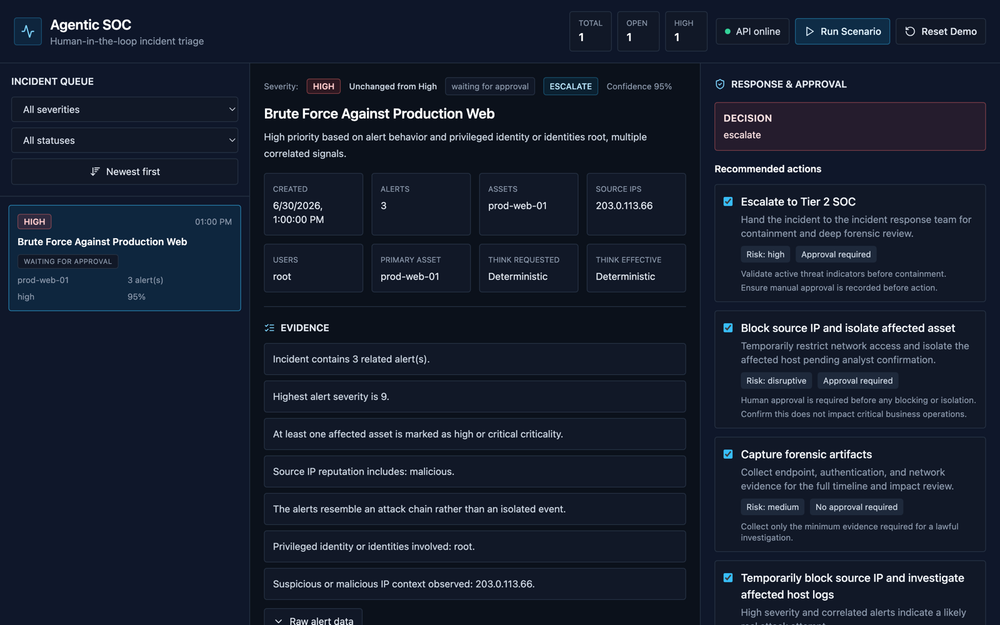
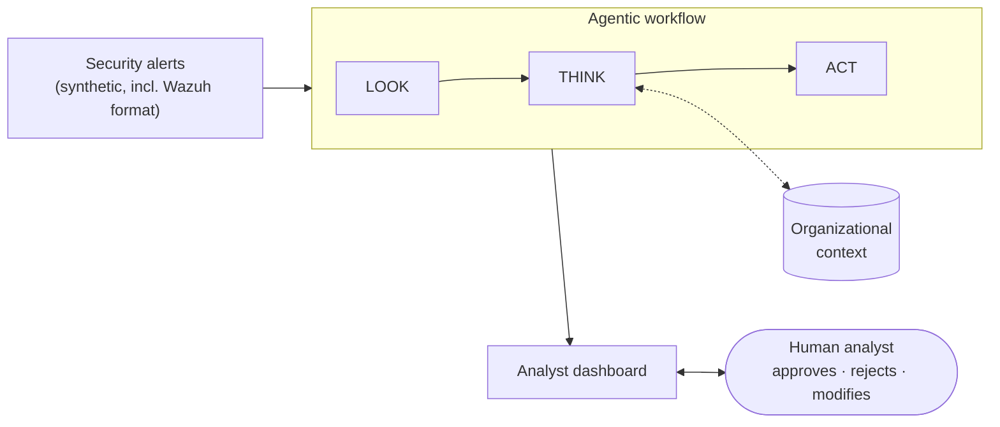
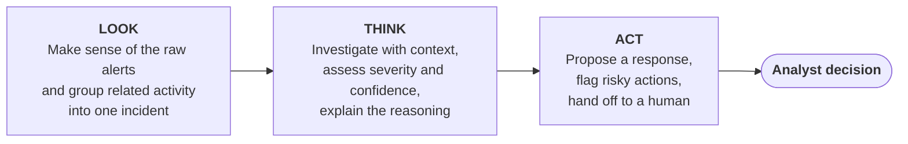
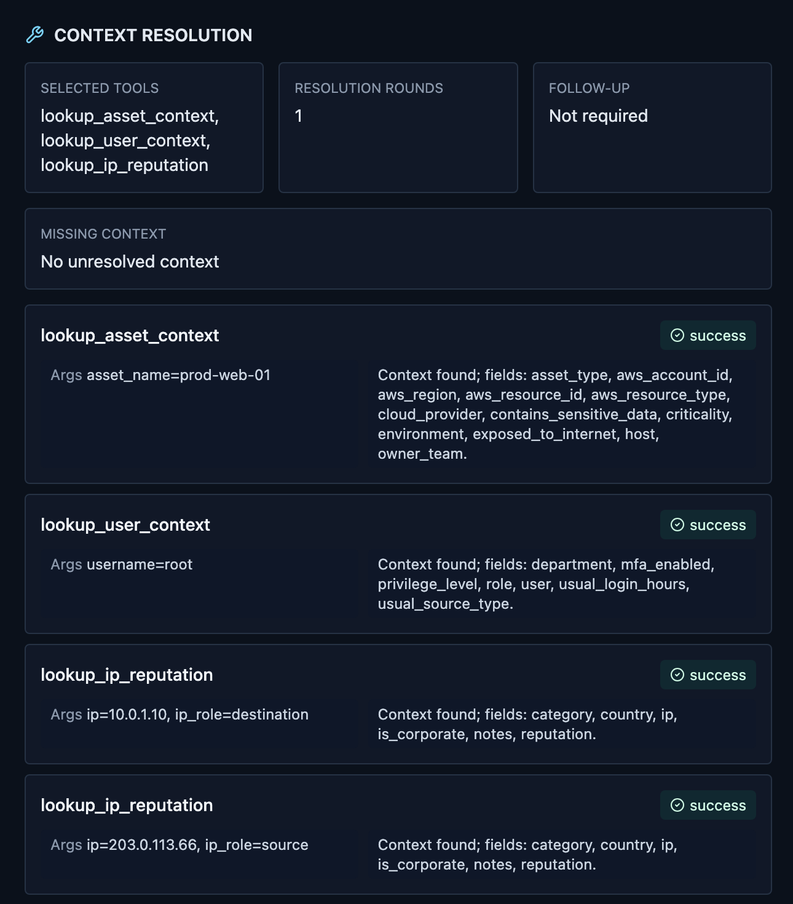
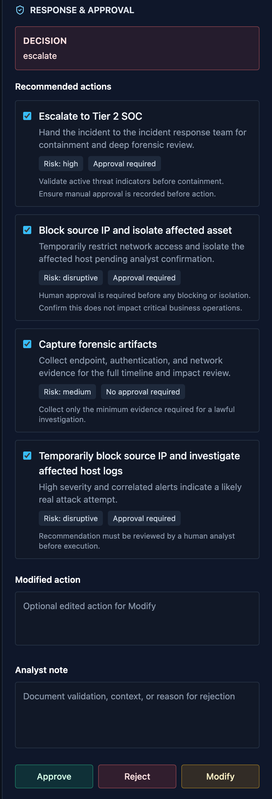

# Agentic SOC

**Context-aware, human-in-the-loop triage for security alerts.**

Agentic SOC is an experimental prototype that explores how an AI agent can help security analysts make sense of alerts faster, without taking control away from them. It groups related alerts into incidents, investigates each one by gathering the context an analyst would look for, explains what it found, and proposes a response. A human then decides what happens next.

> **Status:** experimental prototype. All alerts and organizational context in this project are synthetic. The system never connects to live infrastructure and never executes a response on its own. This repository is a project overview; the source code is not published.

---

## The problem

Security operations teams receive far more alerts than they can investigate. Most alerts are not meaningful on their own. Whether a burst of failed logins is an attack or a user who mistyped a password depends on context:

- **Who** is involved: a regular employee, an administrator, a service account?
- **What** is affected: a developer test machine, or a production server holding customer data?
- **Where** the activity comes from: the corporate VPN, or an address with a malicious reputation?
- **What else** happened around the same time?

Analysts answer these questions by hand, alert after alert. Static scoring rules struggle to capture these combinations, and the same raw alert can deserve opposite responses in different contexts.

Automating the response end to end is tempting, but risky. A wrong containment action, such as blocking an address or isolating a server, can disrupt the business as much as the attack it was meant to stop. Analysts also need to understand *why* a system reached its conclusion before they can trust it.

## The approach

Agentic SOC separates **understanding** an incident from **acting** on it:

- An agent does the investigative legwork. It decides which context it needs, gathers it, weighs the evidence, and produces a clear assessment with its reasoning.
- Every proposed response goes to a human analyst, who can approve, reject, or modify it. The system recommends; it never executes.
- Everything the system observed, looked up, and concluded is shown to the analyst, so they can check the reasoning rather than take it on trust.

---

## How it works

The system is built around three stages, coordinated as an agentic workflow with LangGraph.

**LOOK: from alerts to incidents.** Raw alerts arrive in different shapes from different sources. LOOK brings them into a common form and groups alerts that belong together, such as a port scan, a brute-force attempt, and a suspicious command on the same machine, into a single incident. Analysts then review one story instead of many disconnected alerts.

**THINK: contextual investigation.** This is the agentic core. THINK looks at the incident and decides what it still needs to know. It can look up context about the **assets** involved, the **users** involved, the **reputation of IP addresses**, and **related alerts**. It then produces an assessment: how severe the incident is, how confident it is, how likely the incident is to be a false positive, the evidence behind that judgement, and whether to escalate, keep investigating, or dismiss.

THINK can run in two modes, chosen per run: a **large language model agent** (Google Gemini) that plans its own investigation, or a **deterministic rule-based** engine. The LLM mode shows how flexible, context-driven reasoning compares with fixed rules, while the deterministic mode provides a transparent baseline and a safe fallback if the model service is unavailable.

**ACT: recommend, don't execute.** ACT turns the assessment into concrete recommended actions, labels each with its risk level, flags potentially disruptive steps such as blocking or isolation, and routes everything to an analyst for review.

### What makes it agentic

- **The investigation is not scripted.** In LLM mode the agent chooses which context to gather and when it has enough to decide, rather than following a fixed checklist.
- **Context changes the outcome.** The same raw alert pattern can be assessed as benign or critical depending on who and what is involved, and the system is designed and evaluated with that in mind.
- **The agent works within boundaries.** Its investigation is limited to relevant contextual information, and its conclusions are validated before they are used downstream.

---

## Keeping the human in control

Safety in Agentic SOC is a design principle, not an afterthought:

- **No autonomous action.** The system produces recommendations only. Nothing is blocked, isolated, or changed.
- **Every incident ends with a human decision.** Analysts approve, reject, or modify the proposed actions and can add a note explaining their choice.
- **Risk is made visible.** Each recommended action shows its risk level and whether it needs approval, and disruptive actions are clearly flagged.
- **Reasoning is separated from action.** The LLM investigates and assesses, but the response recommendations are produced by a separate, rule-governed stage.
- **Full transparency.** The dashboard shows the evidence, the context that was looked up, each stage of the workflow, and a complete audit trail of system and analyst activity.

---

## Screenshots

All screenshots come from a local run on synthetic data, using the deterministic mode.

**Incident assessment.** A correlated incident with severity, confidence, evidence, and recommended actions.

<table>
<tr>
<td width="60%" valign="top">

**Contextual investigation.** The context the system looked up to reach its assessment.

</td>
<td width="40%" valign="top">

**Human approval.** Recommended actions with risk levels, and the analyst's approve, reject, and modify controls.

</td>
</tr>
</table>

---

## Tech stack

**Agent orchestration:** LangGraph · **LLM:** Google Gemini (Google Gen AI SDK, tool calling) · **Backend:** Python, FastAPI · **Frontend:** React, TypeScript, Vite, Tailwind CSS · **Alert source format:** Wazuh · **Testing:** unittest/pytest, Vitest, React Testing Library

---

## Evaluation

The technical evaluations below are described at the methodology level only. Numerical results are reported only for the pilot user study.

**Synthetic benchmark.** A set of labelled scenarios covering, among others, brute-force attacks, benign administrator activity, data exfiltration, ambiguous login activity, and cloud identity abuse. Several scenarios are deliberately paired: their raw alerts look alike, but the right answer differs once context is considered. This tests whether the system actually uses context rather than surface patterns.

**Held-out evaluation.** A separate set of Wazuh-style incidents, kept apart from development data, is used to compare the system's severity and decision outputs against predefined expected outcomes. The expected answers are never visible to the system during a run.

**Deterministic vs. LLM comparison.** An evaluation harness runs the same scenarios through both THINK modes to compare their assessments and how they use context.

**User study.** A pilot user study (N=17) compared assessment of synthetic security incidents under two conditions: a Manual condition using alerts and contextual lookups, and an Agentic condition that additionally provided correlated analysis, severity and confidence, evidence and reasoning, and a recommended response. Two survey versions were used with different scenarios across conditions. Participants selected from the same five decision options in both conditions and rated clarity, usefulness, understanding, comfort in following or overriding the recommendation, and expected reduction in triage effort. The Agentic condition was presented first in both versions.

In the pilot, 17/17 participants reported that the Agentic condition made incidents easier to assess and expected it to reduce triage effort; 16/17 said it helped them understand the incident and would be useful in practice. 15/17 reported being comfortable following or overriding the recommendation, and 14/17 said they understood the system's conclusion.

The project is also covered by automated backend and frontend tests, with LLM interactions mocked so that tests are reproducible.

---

## Limitations

- **Synthetic data.** All alerts, users, assets, and IP reputation are synthetic, and the context available is much smaller than in a production SOC.
- **No live integrations.** Wazuh support is file-based, with no connection to a live SIEM or to response tooling.
- **Prototype persistence.** Incidents and decisions are held in memory and are lost on restart.
- **Recommendation-only.** By design, no response action is ever executed.
- **Small evaluation scale.** The benchmark and held-out sets are small and hand-constructed, so findings are indicative, not statistically conclusive.
- **Pilot user study.** The pilot sample was small (N=17) and used synthetic scenarios. The Agentic condition was always presented first, so order effects cannot be excluded.
